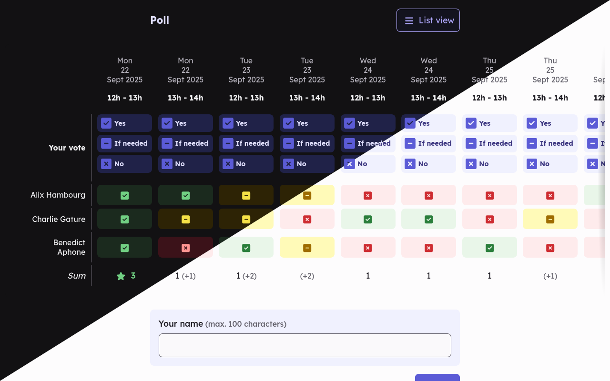

# Pollaris (Wikimedia Toolforge Edition)

Pollaris is a decision-making and scheduling tool built for Wikimedia communities, user groups, and projects. While anyone can participate in open polls without creating an account, poll creators and community managers authenticate via Wikimedia OAuth.

This edition is deployed on [Wikimedia Toolforge](https://pollaris.toolforge.org) and adapted for the Wikimedia ecosystem.

## Features

### Wikimedia integration
- **Wikimedia OAuth login**: Log in directly with your Wikimedia global account.
- **Vote eligibility requirements**: Restrict voting to users meeting specific edit count thresholds on any Wikimedia wiki (e.g. minimum 50 edits on `eswiki` or `commonswiki`).
- **User attribution**: Displays Wikimedia usernames linked to their global profiles.

### Communities
- **Spaces for chapters and user groups**: Organize polls under dedicated communities with custom slugs.
- **Access control**: Communities support open membership or invite links with token regeneration.
- **Activity dashboard**: Track member lists, active consultations, and communication channels.

### Notifications
- **Automated emails (Wikimedia Codex style)**: HTML emails for new polls and daily reminders.
- **One-click opt-out**: Members can mute community emails or opt out of specific polls with signed unsubscribe links.
- **Telegram Bot integration**: Connect community groups with `@pollariswikibot` to receive new poll announcements, daily reminders with inline voting buttons, and commands (`/recordatorio`, `/encuestas`, `/ayuda`). Shows the leading option when there is a clear front-runner.

### Multilingual & Internationalization
- **Multilingual titles and descriptions**: Translate polls and communities into multiple languages with live client-side switching.
- **Translatewiki.net integration**: Web interface translations contributed by volunteers worldwide, with a live `/credits` dashboard.
- **Timezone handling**: Date polls display times in the survey's timezone as well as UTC.

## Tech stack

- **Backend**: PHP 8.4, Symfony 7, Doctrine ORM, MariaDB (Wikimedia Cloud Services).
- **Frontend**: Hotwired Turbo & Stimulus, esbuild, Wikimedia Codex design tokens.
- **Infrastructure**: Kubernetes webservices and scheduled jobs on Wikimedia Toolforge.

## Documentation

- [Administrators Guide](/docs/administrators/README.md)
- [Developers Guide](/docs/developers/README.md)

## License

Pollaris is free software licensed under the [GNU Affero General Public License v3.0 or later (AGPL-3.0-or-later)](https://framagit.org/pollaris/pollaris/-/blob/main/LICENSE.txt).

## Credits

Based on the original [Pollaris](https://framagit.org/pollaris/pollaris) project by Marien Fressinaud and Bileto. Modified and maintained for Wikimedia Toolforge by Daniel Yepez Garces. Interface translations courtesy of the [Translatewiki.net](https://translatewiki.net) community.
